# Manual de usuario — VendeDTo

**Versión:** 1.2 · **Fecha:** 2026-10-27
**Dirigido a:** el **Dueño** (Administrador de tienda) y sus **Empleados** (Usuario de tienda).

**Cómo leerlo.** La **Parte 1** es la puesta en marcha: se hace una vez, cuando montas la
tienda. Las **Partes 2 a 6** son el uso del día a día. Cada sección termina con una
**Imagen sugerida**: la captura del POS que conviene poner y qué debe mostrar.

---

## Antes de empezar: cómo funciona el sistema

- **Dos roles importan aquí.** El **Dueño** (Administrador de tienda) monta y configura todo.
  El **Empleado** (Usuario de tienda) opera: vende, cobra, registra. Hay funciones que solo
  ve el Dueño (configurar el catálogo web, los pedidos de WhatsApp, los empleados…).
- **Funciona sin conexión.** Salvo el Catálogo Web y los Pedidos WhatsApp, que van contra el
  servidor, casi todo el POS trabaja con los datos guardados en el propio dispositivo. Por eso
  conviene instalar la app en el equipo y activarle el **acceso sin conexión** (Parte 1, paso 7).
- **Los módulos activan funciones.** La tienda tiene un plan, y según los módulos activos
  aparecen unas pantallas u otras (multi-moneda, créditos, gastos, multi-tienda, catálogo web,
  pedidos de WhatsApp…). Si en tu menú no ves un apartado, es que esa función no está activa.
- **Un dato vive en la tienda seleccionada.** Todo lo que registras (ventas, inventario,
  gastos…) pertenece a la tienda que tienes seleccionada en ese momento.
- **El carrito es global.** El ícono del carrito vive en el encabezado de la app y se comparte
  entre las pantallas de venta: armas la venta y la confirmas desde ahí (Parte 2).

### El menú (barra lateral)

Aquí viven **todas las vistas**. Se abre con la **doble flecha** del encabezado y se cierra con la
**doble flecha** de su propio encabezado. Está agrupado por bloques (**VENTA**, **CATÁLOGO WEB**,
**INVENTARIO**, **GASTOS**, **SINCRONIZACIÓN**, **REPORTES**, **ESTADÍSTICAS**, **GESTIÓN**), y
**cada opción lleva un `?` que abre la ayuda de esa vista**.

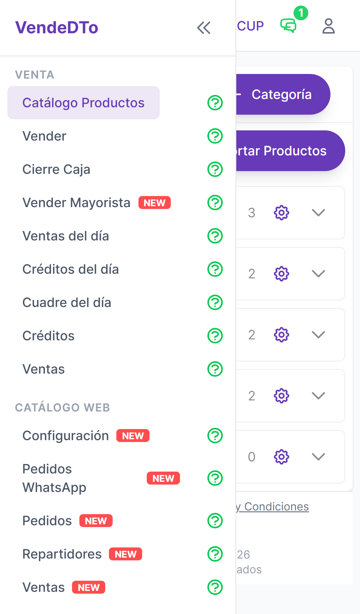

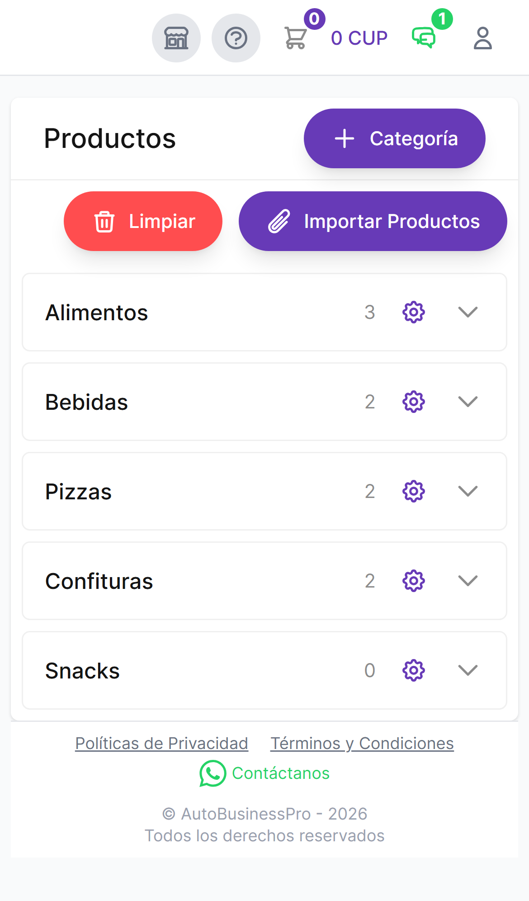

### El encabezado (barra superior)

De izquierda a derecha:

- **Doble flecha** — abre la **barra lateral** de menú cuando está cerrada.
- **Tienda** — **cambiar de tienda** (solo el Dueño, y solo si tiene más de una tienda).
- **Signo de interrogación** — abre el **Tutorial** (la ayuda de la app); al pulsarlo de nuevo,
  vuelve a la vista donde estabas.
- **Carrito** — la **venta en curso**: cuántos artículos llevas (el número) y el **total** al
  lado. Se usa desde cualquier pantalla de venta.
- **Burbuja de chat (verde)** — el **chat de soporte** con el administrador de la plataforma;
  el número indica mensajes sin leer.
- **Campana** — avisos de la plataforma (solo para la administración).
- **Persona** — **menú de usuario**: tu usuario y tu nombre, y las opciones **Editar Perfil**,
  **Cambiar Contraseña** y **Salir**.

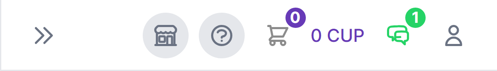

### El pie de página

- **Políticas de Privacidad** y **Términos y Condiciones** — los documentos legales (abren en
  una pestaña nueva).
- **Contáctanos** — abre un chat de **WhatsApp** con el soporte. **Solo aparece con la sesión
  iniciada** (en la pantalla de acceso no se muestra).

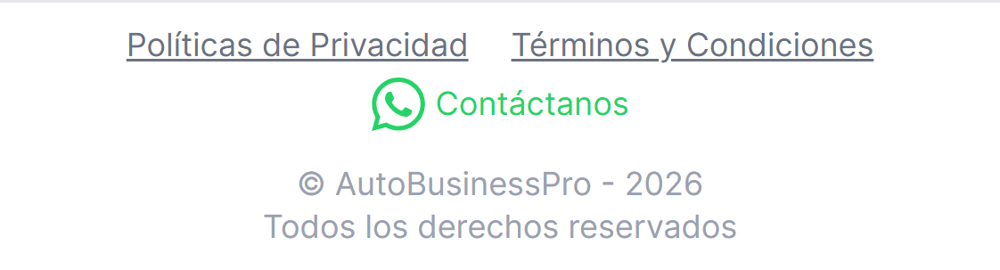

---

# Parte 1 — Puesta en marcha (el Dueño, una sola vez)

## 1. Crear la cuenta e instalar la app

**Qué es.** El alta del propietario: crea tu cuenta y tu primera tienda a la vez, y deja el POS
instalado en el dispositivo.

**Cómo se hace.**
1. Entra en la pantalla de **Creación de cuenta**.
2. Rellena: **Nombre completo**, **Nombre de la tienda**, **Usuario**, **Contraseña**,
   **Confirmar contraseña**, **Teléfono celular** y **Email** (el único opcional).
3. La contraseña debe tener al menos **8 caracteres, una mayúscula y un número**.
4. Marca la casilla de **términos y condiciones** (hay un enlace para leerlos).
5. Pulsa **Registrar**. La cuenta se crea, **entra automáticamente** y te lleva a tu **página
   de inicio** (el catálogo **Productos**, todavía vacío porque aún no has cargado nada).
6. **Instala la app en el dispositivo.** En tu **página de inicio** verás el botón flotante
   **INSTALAR APP**: púlsalo. El dispositivo **añade el ícono de la app automáticamente**;
   espera a verlo aparecer en la pantalla de inicio (o en el escritorio) y abre la app desde
   ahí a partir de ahora — así trabaja **sin conexión**. Cuando la app queda instalada, el
   botón **desaparece** (ya no hace falta).

**A tener en cuenta.** Todo es obligatorio salvo el email. Si el alta se interrumpe justo al
final, la cuenta ya puede existir: se te avisa y se te lleva a la pantalla de acceso.

**📷 Imagen sugerida.**

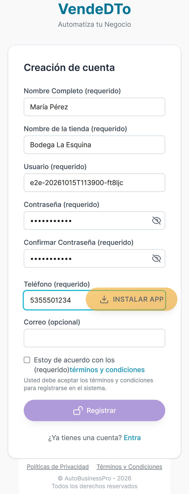

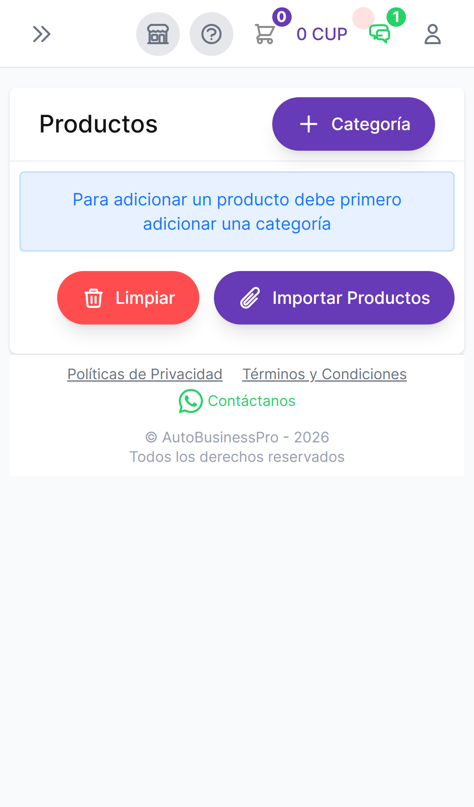

## 2. Primer acceso

**Qué es.** Entrar con usuario y contraseña y llegar a la pantalla de inicio.

**Cómo se hace.**
1. En **Inicia sesión en tu cuenta**, escribe **Usuario** y **Contraseña** (el ojo muestra u
   oculta la contraseña).
2. Pulsa **Iniciar sesión**. Verás un aviso de carga mientras se resuelve tu sesión.
3. Aterrizas en tu pantalla de inicio: la venta si la tienda ya tiene productos vendibles, o el
   catálogo de productos si aún no.

**A tener en cuenta.** Si la cuenta está desactivada, o fallas muchas veces seguidas, se te
avisa con un mensaje claro. Una sesión ya iniciada que vuelve a la pantalla de acceso se
redirige sola a su inicio.

**📷 Imagen sugerida.**

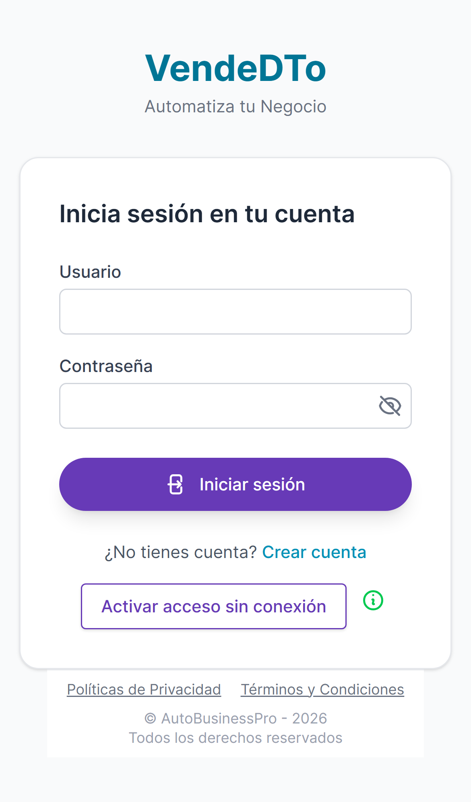

## 3. Configurar la tienda (monedas, métodos de pago y tasas)

**Qué es.** Dejar lista la forma de cobrar antes de vender: con qué monedas trabajas, qué métodos
aceptas y a qué tasa cambias.

**Cómo se hace.**
1. Ve a **Gestión → Configuraciones**.
2. (Solo multi-tienda) En **Tienda activa**, elige la tienda que vas a configurar.
3. (Solo con el módulo de múltiples monedas) En **Monedas de compra y venta** elige la
   **Moneda de Compra** y la **Moneda de Venta**.
4. En **Métodos de pago**, activa o desactiva los métodos con su interruptor. Los canales en
   **Efectivo están siempre activos** y su interruptor no se puede apagar.
5. (Solo con el módulo de múltiples monedas) Si necesitas cambiar valores, ve a **Tasas de
   Cambio** (ver la sección 30) y registra la tasa de cada moneda por método de pago.

**A tener en cuenta.** El catálogo de **categorías de producto** no está aquí: se gestiona en
**Productos**. Esta pantalla guarda al instante (verás **Guardado**).

**📷 Imagen sugerida.**

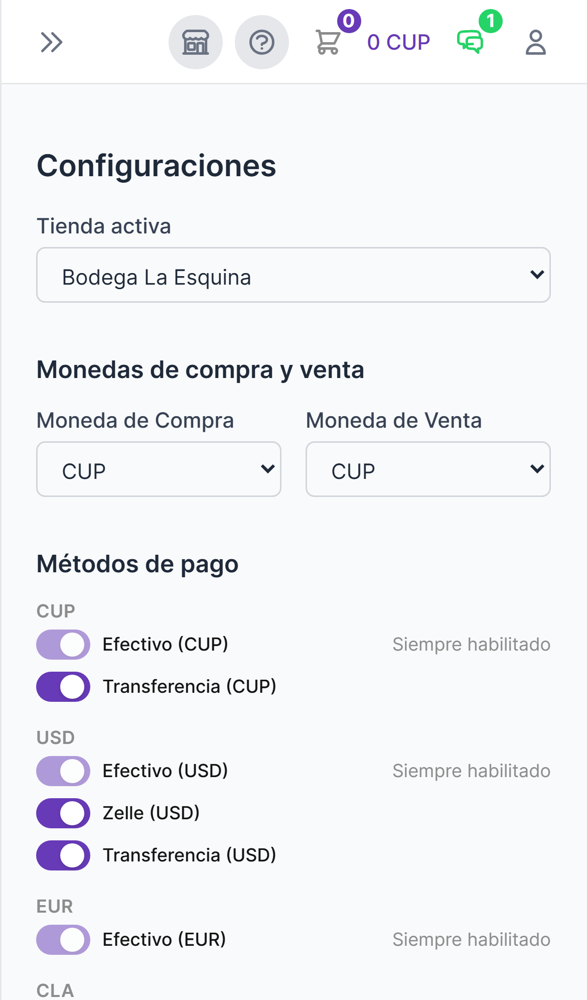

## 4. Cargar el catálogo de productos

**Qué es.** Dar de alta tus productos y organizarlos por categorías. Es la base de todo: sin
productos no se puede vender.

**Cómo se hace.**
1. Ve a **Ventas → Catálogo Productos** (título de la tarjeta: **Productos**).
2. Crea una **categoría** con el botón **Categoría** de la cabecera.
3. Con el engranaje de la categoría, añade productos: **Productos** para un alta rápida de varios,
   o **Producto** para un alta individual.
4. En el formulario del producto rellena **Nombre**, **Precio** (y su moneda si tienes varias),
   **Cantidad**, **Orden**, y marca **Activo**, **Disponible para Vender** y, si corresponde,
   **Descuenta del Inventario**. Puedes añadir **Código de barras** y la configuración mayorista.
5. Para cargas grandes, usa **Importar Productos** (CSV): descarga el ejemplo, rellénalo y súbelo.

**A tener en cuenta.** Si registras un producto con costo y cantidad, se crea además una
**entrada de inventario** del día. Desactivar un producto **no lo borra**: queda listado y
atenuado como inactivo, y puede reactivarse.

**📷 Imagen sugerida.**

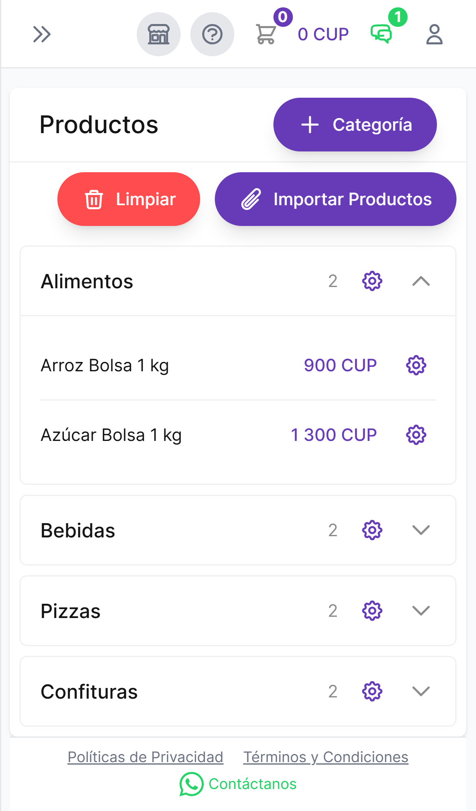

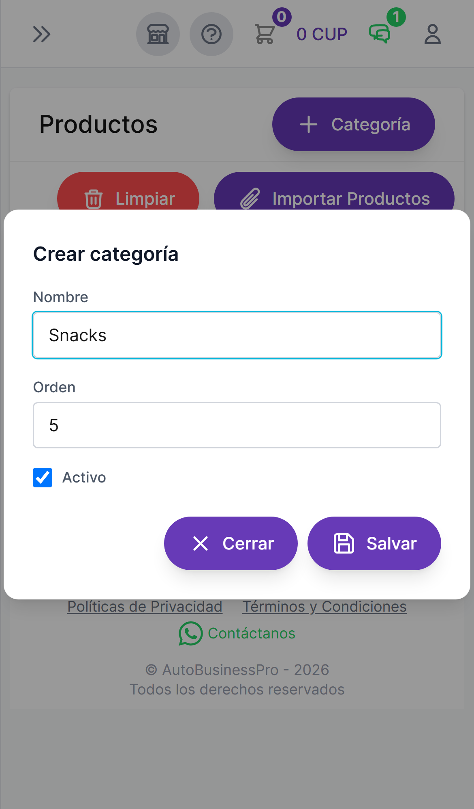
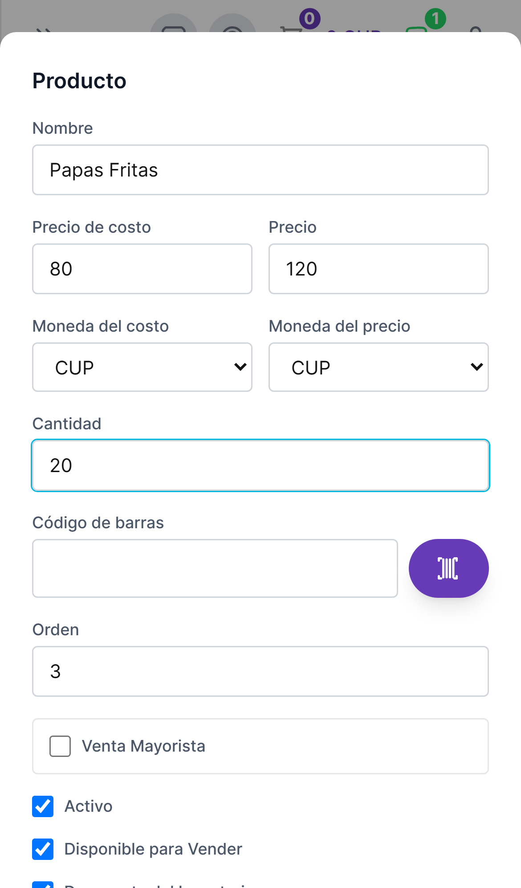

## 5. Registrar las primeras entradas de inventario

**Qué es.** Meter el stock inicial de los productos.

**Cómo se hace.**
1. Ve a **Inventario → Entradas del día**.
2. Pulsa **Entrada**, elige el **producto**, la **cantidad** y el **costo**, y guarda.
3. Repite por cada producto que tenga existencias.

**A tener en cuenta.** La **fecha la pone el sistema** (es del día): no se puede registrar una
entrada con fecha pasada. Corregir el costo de una entrada **se propaga** a las ventas ya hechas
de ese producto.

**📷 Imagen sugerida.**

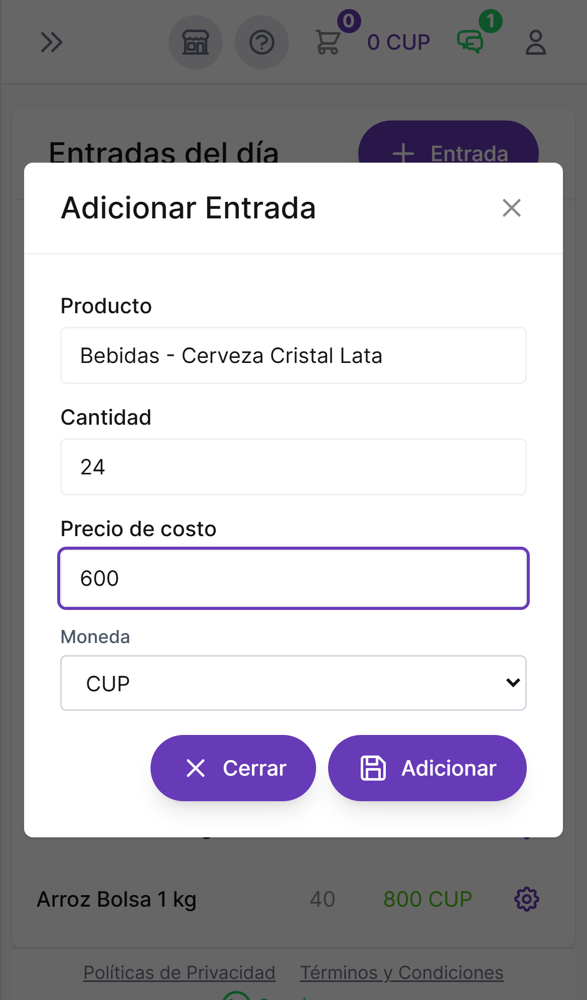

## 6. Crear los empleados

**Qué es.** Dar de alta a las personas que usarán el POS, cada una con su propio usuario y
contraseña.

**Cómo se hace.**
1. Ve a **Gestión → Empleados** (título: **Empleados**).
2. Pulsa **+ Empleado** y rellena **Nombre Completo**, **Usuario**, **Contraseña**,
   **Confirmar Contraseña** y **Teléfono**. El **Correo** es opcional.
3. Pulsa **Adicionar**. El empleado queda creado con el rol de **Usuario de tienda**.
4. En la tarjeta de cada empleado, el engranaje abre **Editar**, y **Activar** o **Desactivar**
   según su estado.

**A tener en cuenta.** Esta pantalla necesita **conexión**. La **Contraseña** debe tener entre
8 y 30 caracteres e incluir al menos una mayúscula, una minúscula y un número. El **Usuario** no
se puede cambiar después de crear la cuenta. Los datos del empleado pertenecen a la tienda que
tengas seleccionada. Un empleado **desactivado** aparece con la tarjeta en rojo y no puede
iniciar sesión.

**📷 Imagen sugerida.**

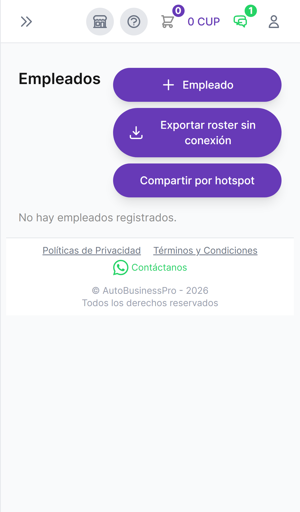

## 7. Activar el acceso sin conexión en los equipos

**Qué es.** Preparar un equipo para que el empleado pueda entrar y trabajar **sin internet**.
Esto se hace con el **roster** (la lista de empleados con contraseña).

**Cómo se hace.**
1. En el equipo del Dueño, ve a **Gestión → Empleados** y pulsa **Exportar roster sin conexión**;
   escribe la **Contraseña maestra** y pulsa **Confirmar**. Se descarga un **archivo de roster**
   con extensión `.smcabundle`.
2. Lleva ese archivo al equipo del empleado (por ejemplo con **Compartir por hotspot**).
3. En el equipo de destino, abre el **Acceso sin conexión** en la pantalla de acceso, elige el
   **Archivo de roster (.smcabundle)**, escribe la **Contraseña maestra** y pulsa **Activar**.
4. Desde entonces, ese equipo puede iniciar sesión aunque no haya internet.

**A tener en cuenta.** Solo se incluyen en el roster los empleados **activos**: si desactivas a
alguien, vuelve a exportarlo. Para **desactivar** el acceso sin conexión se pide confirmación; si
el dispositivo tiene datos cifrados y no hay otra copia de la clave, se te avisa del riesgo de
pérdida.

**📷 Imagen sugerida.** El panel de **Acceso sin conexión** abierto con sus dos opciones
(*Activar* / *Desactivar*) y, si se puede, el modal de activación con el archivo y la contraseña.

---

# Parte 2 — El día a día del empleado

## 8. Vender

**Qué es.** Armar una venta normal y confirmarla.

**Cómo se hace.**
1. Ve a **Ventas → Vender** (**Productos para vender**).
2. Encuentra el producto: escríbelo en el buscador, usa el **escáner** de código de barras, o
   navega por categorías (el interruptor **Todos** muestra todas).
3. En la fila del producto, indica la **Cantidad** y pulsa **Añadir**. La disponibilidad aparece
   entre paréntesis junto al nombre.
4. Repite con el resto de líneas. El **carrito** (ícono del encabezado) va sumando.
5. Abre el carrito, revisa la **Venta actual** y pulsa **Registrar**.

**A tener en cuenta.** Si un producto descuenta del inventario y no hay stock suficiente, el
sistema te lo dice antes de dejarlo añadir. Tras registrar, las cantidades se refrescan solas.

**📷 Imagen sugerida.**

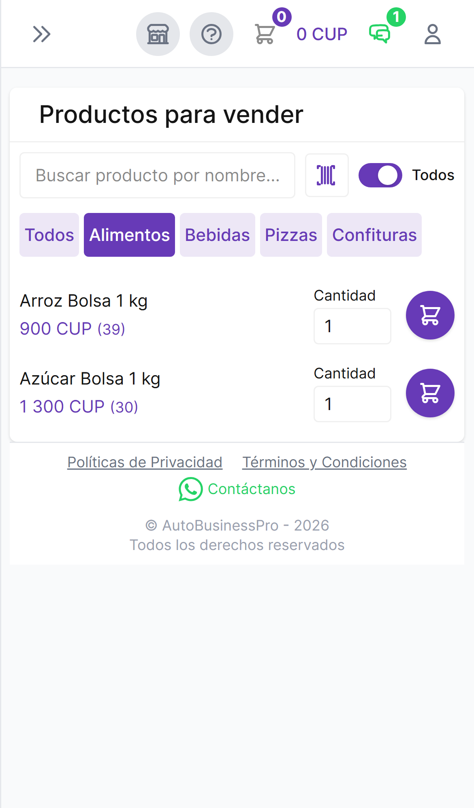

## 9. Cobrar (método de pago, crédito y vuelto)

**Qué es.** Elegir cómo paga el cliente y confirmar la venta desde el carrito.

**Cómo se hace.**
1. Abre el **carrito**.
2. Elige la **moneda** de la venta (si tienes varias).
3. Elige el **método de pago** (Efectivo, Transferencia, Zelle…).
4. En **efectivo**, escribe *con cuánto paga* y la app calcula el **Vuelto**.
5. Si la venta es **a crédito**, activa el interruptor **Crédito** y escribe el **Cliente**.
6. Pulsa **Registrar**.

**A tener en cuenta.** No se puede registrar un carrito **vacío**, ni cobrar **menos** que el
total, ni dejar un **crédito sin cliente**. No se pueden mezclar ventas normales y mayoristas en
el mismo carrito.

**📷 Imagen sugerida.**

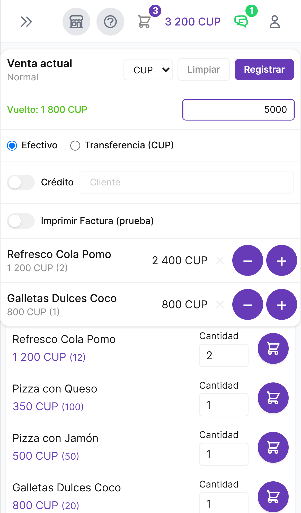

## 10. Vender al mayor (por paquetes)

**Qué es.** Vender por paquetes, con precio por unidad según el tamaño de la compra.

**Cómo se hace.**
1. Ve a **Ventas → Vender Mayorista**.
2. Busca o escanea el producto; pulsa el **?** de la fila para ver los **rangos** de precio.
3. Escribe la **cantidad de paquetes** (el mínimo es el primero del rango) y **añade**.
4. La fila muestra la cotización (*paquetes × tamaño × precio = total*).
5. Confirma desde el carrito igual que una venta normal.

**A tener en cuenta.** Solo aparecen los productos configurados como mayoristas. En el carrito,
**+** y **−** mueven **paquetes** (no unidades), y bajar por debajo del primer rango elimina la
línea.

**📷 Imagen sugerida.**

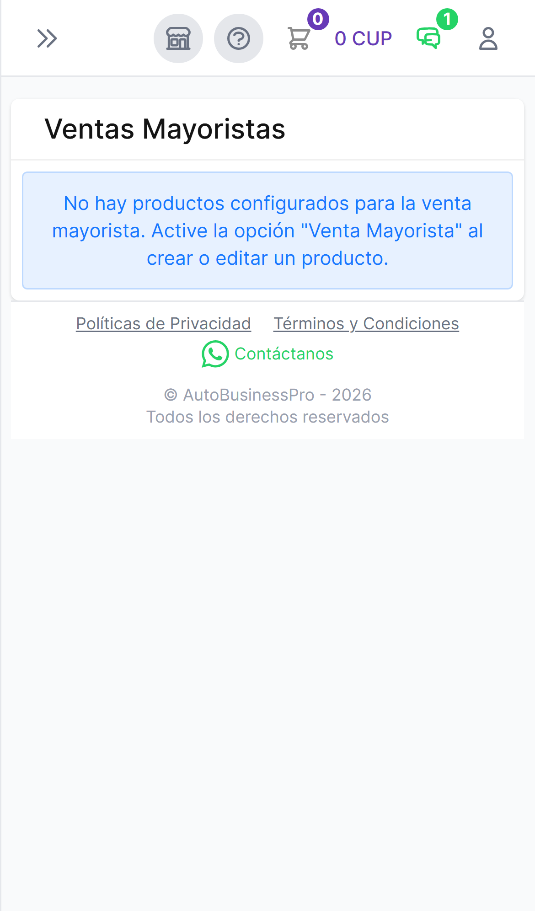

## 11. Cobrar un crédito

**Qué es.** Marcar como pagada una venta que se dejó a crédito.

**Cómo se hace.**
1. Ve a **Ventas → Créditos de hoy** (o al **Historial de créditos** para días anteriores).
2. Localiza al cliente en la lista.
3. Pulsa **Pagar** en la fila del crédito y confirma.

**A tener en cuenta.** En el historial (**Créditos**), el filtro arranca en **Por Pagar**. Puedes
filtrar por rango de fechas y por estado (**Todos / Por Pagar / Pagados**).

**📷 Imagen sugerida.**

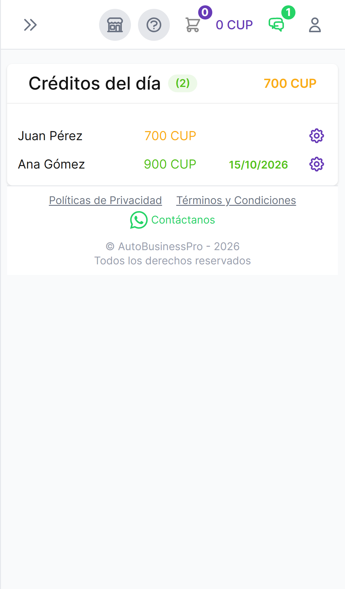

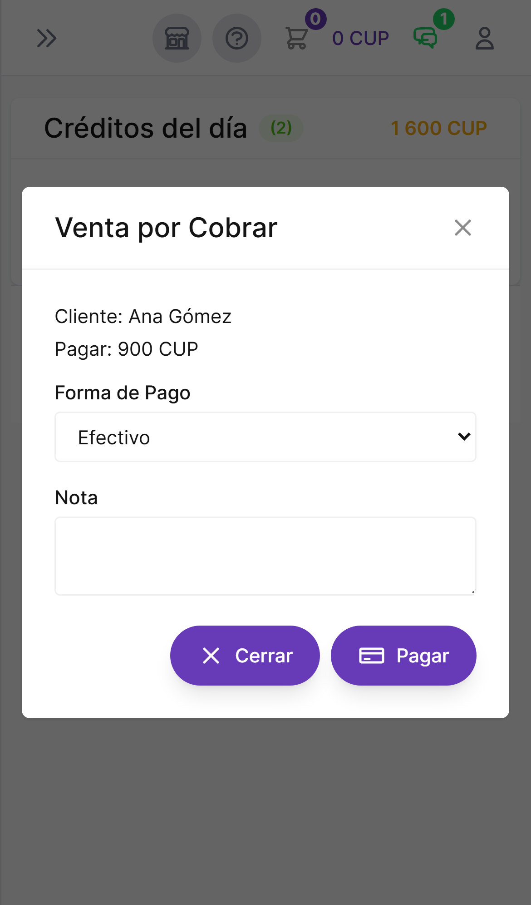

**Historial de créditos** (para días anteriores):

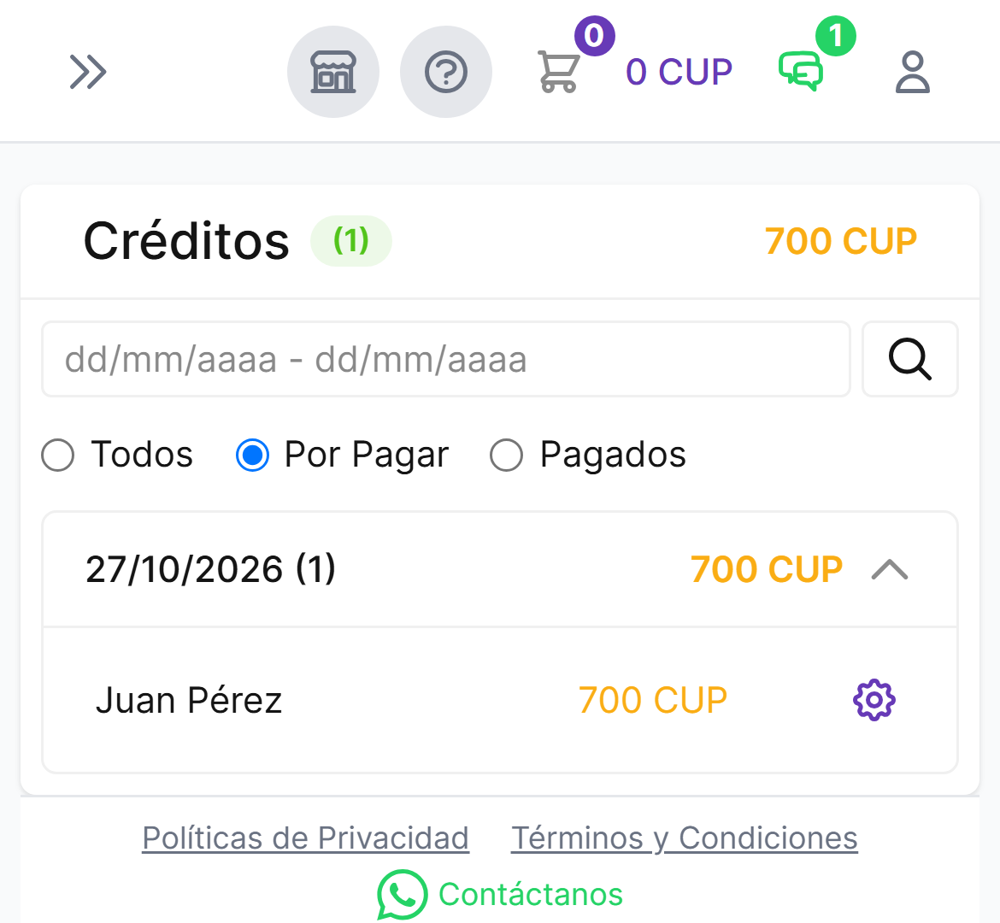

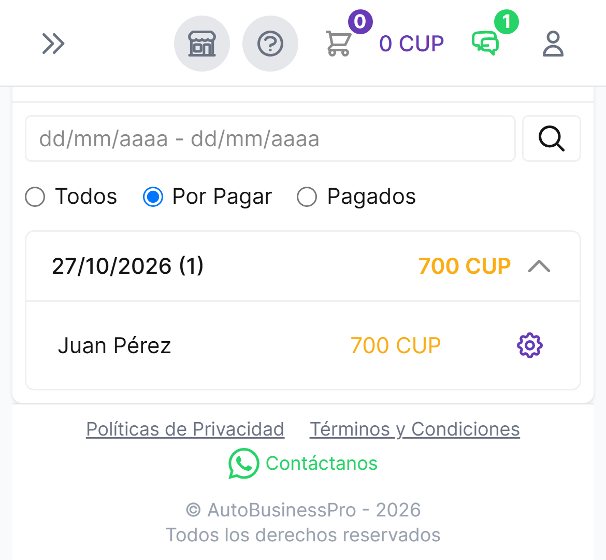

## 12. Cierre de caja

**Qué es.** Cuadrar el **efectivo** del día y cerrar la caja: la apertura, el conteo por
denominaciones y la diferencia.

**Cómo se hace.**
1. Ve a **Ventas → Cierre Caja** (**Cierre Efectivo**).
2. Escribe el valor de la **Apertura** (el efectivo con el que arranca la caja).
3. En la tarjeta **Conteo**, escribe cuántos billetes/monedas hay de cada **denominación**. Si
   necesitas una denominación que no está, usa **Nueva denominación** y **Agregar**.
4. Revisa las tarjetas **Esperado**, **Contado** y **Diferencia** (roja si falta, verde si sobra).
5. Pulsa **Cerrar Caja** y confirma. Si la **Diferencia no es cero**, el **Comentario** es
   obligatorio.

**A tener en cuenta.** Cuadra **solo el efectivo** (no transferencias ni Zelle). Mientras el día
está **Abierta** puedes seguir llenándolo; al cerrar, todo queda bloqueado. Si tienes varias
monedas, hay un registro por **día y moneda** (usa el filtro de moneda).

**📷 Imagen sugerida.**

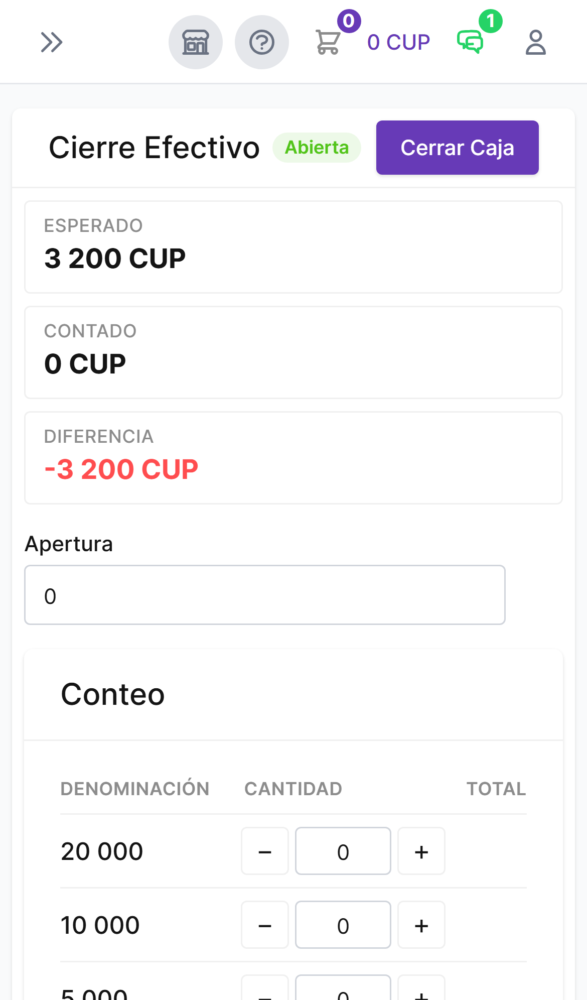

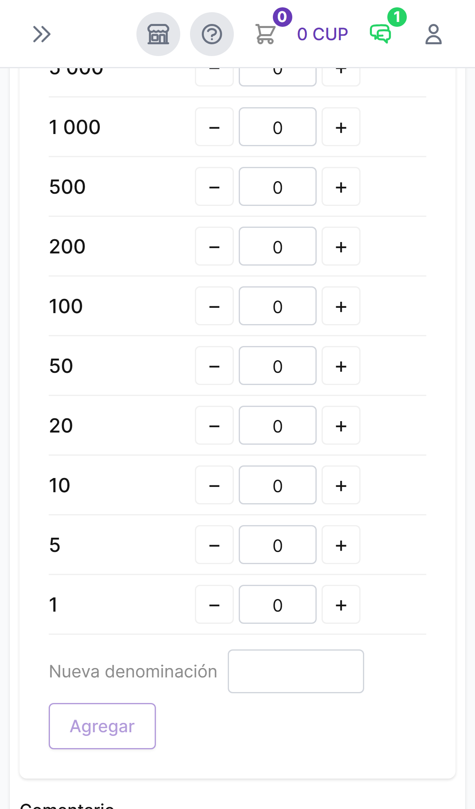

## 13. Ver tus ventas y el cuadre del día

**Qué es.** Consultar lo vendido hoy y cómo va la caja.

**Cómo se hace.**
- **Ventas del día** (**Ventas → Pedidos de hoy**): lista de las ventas de hoy con filtro por
  **método de pago**, por estado (**Todas / Pagadas / Créditos**) y por moneda. Desde el engranaje
  de una venta puedes **Editar** o **Eliminar/Cancelar**.
- **Cuadre del día** (**Ventas → Cuadre del día**): paneles colapsables con **Resumen Efectivo**
  (ventas en efectivo + créditos pagados − gastos), **Pago por Transferencia**, **Gastos**,
  **Créditos por cobrar**, **Créditos pagados** y **Ventas por categoría**.

**A tener en cuenta.** El **Cuadre del día** es una foto de control; el cierre formal del efectivo
es la sección 12.

**📷 Imagen sugerida.**

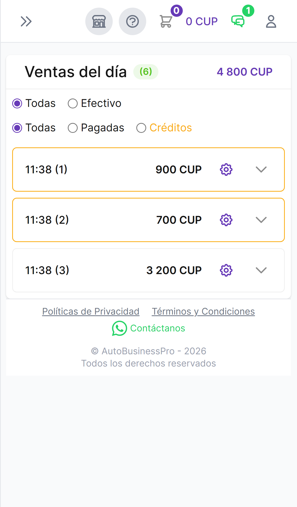

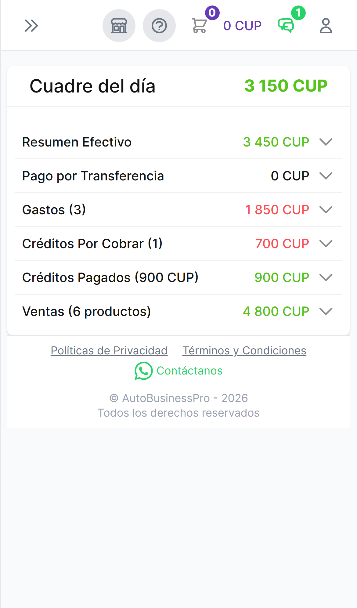

## 13.1 Historial de ventas

**Qué es.** Consultar **todas** las ventas guardadas (no solo las de hoy), con filtros y el
detalle agrupado por día; y, si tienes varias tiendas, verlas juntas en una sola pantalla.

**Cómo se hace.**
1. Ve a **Ventas → Ventas**. El encabezado muestra cuántas ventas entran en el filtro y su
   importe total.
2. Filtra por **rango de fechas**, por **método de pago** (Todas / Efectivo / …) y por estado
   (**Todas / Pagadas / Créditos**). Si tienes varias monedas aparece también el filtro de
   **moneda**.
3. Pulsa un **día** para desplegar sus ventas. Cada venta muestra su hora, su método de pago y
   su total; con la flecha de la venta ves su detalle.
4. Con el **engranaje del día** puedes **generar el reporte** de ese día o abrir el **Resumen
   de ventas** del día.

**Con varias tiendas.** Si eres **Dueño** y tienes el módulo **MultiStores** con **dos o más
tiendas activas**, la misma pantalla cambia a paneles por tienda:
- Arriba eliges **Todas las tiendas** o una tienda concreta.
- Cada tienda es un **panel colapsable** con su contador y su total; dentro va el acordeón por
  día con las ventas de **esa** tienda.
- Los filtros de **fechas**, **método de pago**, **Pagadas/Créditos** y **moneda** son
  **globales**: se aplican a todas las tiendas a la vez.

**A tener en cuenta.** El historial es **solo lectura**: aquí no se editan ni se eliminan
ventas. Para editar o cancelar una venta de hoy usa **Ventas del día**. Una venta cancelada no
aparece en el historial.

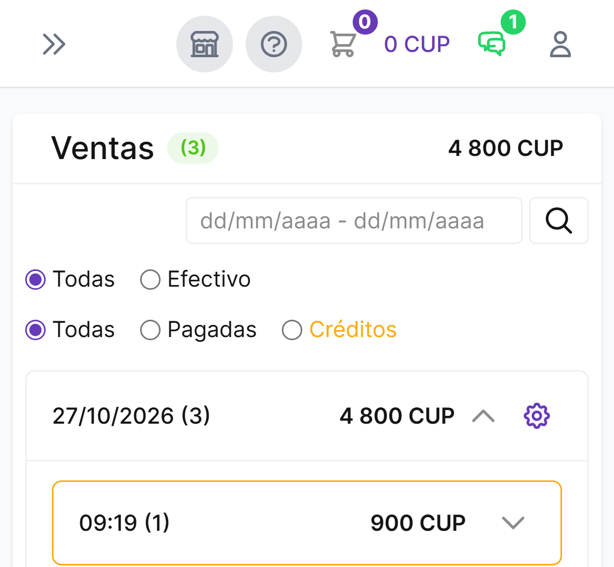

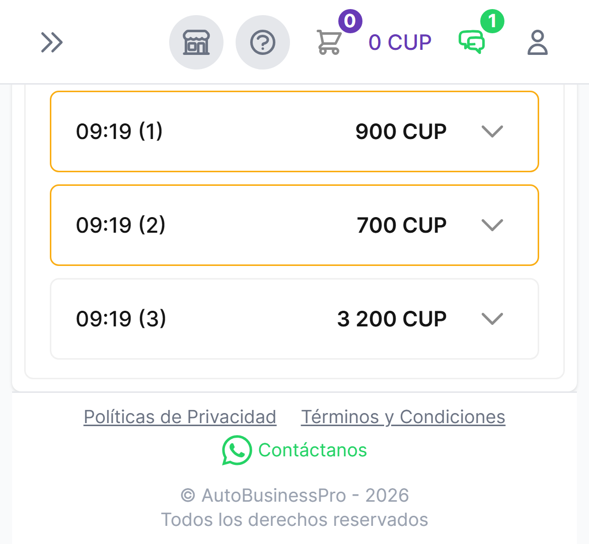

**Con varias tiendas**, el historial se reparte en un panel por tienda:

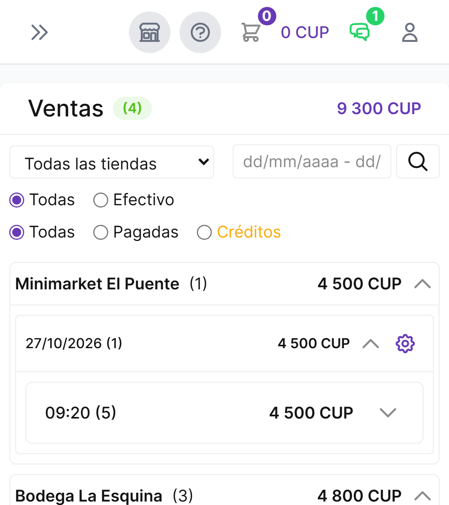

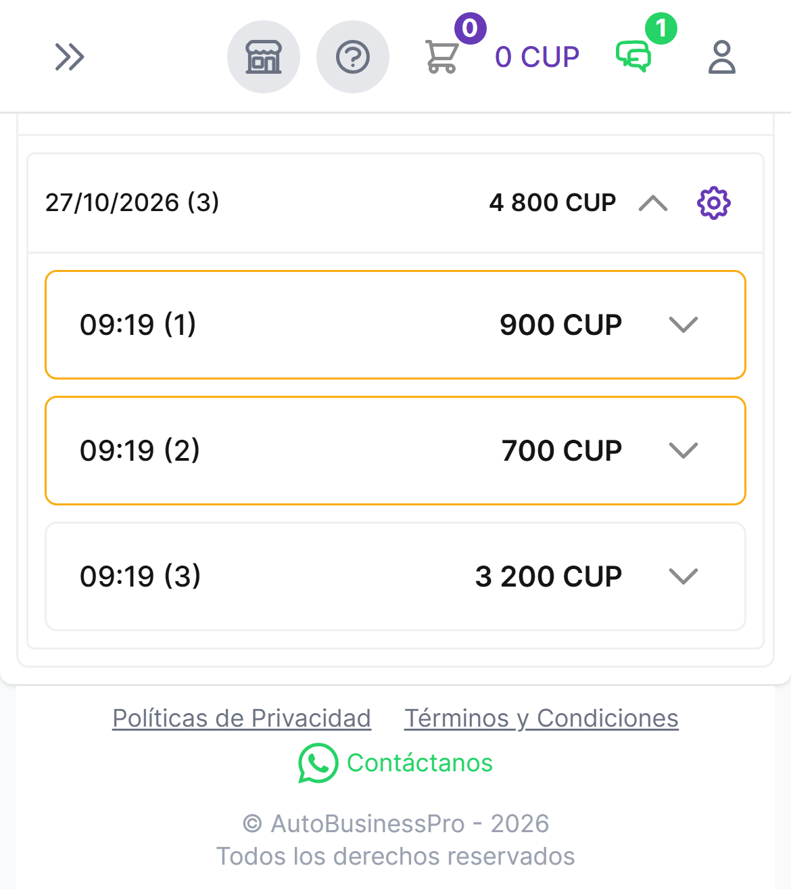

---

# Parte 3 — Inventario

> El inventario de la tienda es **local**: se consulta sin conexión y refleja lo que se ha
> registrado en el dispositivo.

## 14. Inventario disponible

**Qué es.** Consultar el stock por categoría y producto, su costo y su valor.

**Cómo se hace.**
1. Ve a **Inventario → Disponible** (título: **Inventario**). Verás las categorías colapsadas.
2. Expande la categoría y revisa cada producto: nombre, **cantidad del sistema** entre paréntesis,
   costo unitario y valor total.
3. Usa el buscador (**Buscar producto**) para localizar uno.

**A tener en cuenta.** El **conteo** no está en esta vista: tiene la suya propia (la siguiente).

**📷 Imagen sugerida.**

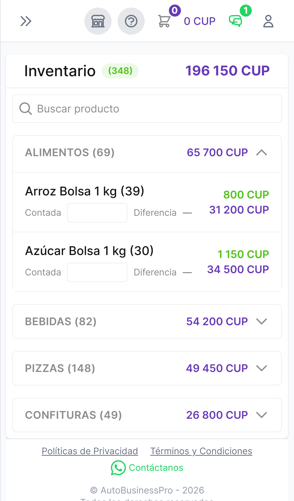

## 14.1 Conteo de productos

**Qué es.** La vista de **conteo**: recorrer los productos, escribir lo que hay realmente y ver la
**diferencia** contra el sistema. Es **solo de conteo** y **no ajusta** el stock.

**Cómo se hace.**
1. Ve a **Inventario → Conteo de productos** (título **Conteo de productos** con el número de
   productos).
2. Expande una categoría (paneles colapsables, como en las otras vistas).
3. En cada producto verás el número de fila, el nombre y **Sistema: N**. Escribe lo contado en
   **Conteo**.
4. La **diferencia** (contada − sistema) se resalta: **negativa** con signo `-` en **rojo**; **cero
   o positiva** en **verde** con `+`. Sin escribir nada, muestra `—`.
5. Para empezar de cero, pulsa **Limpiar**: borra todos los conteos y deja la vista en blanco.

**A tener en cuenta.** Es **solo visual**: no guarda nada (ni en el dispositivo) y **no** modifica
el stock. Si recargas o sales de la vista, los conteos se pierden.

**📷 Imagen sugerida.**

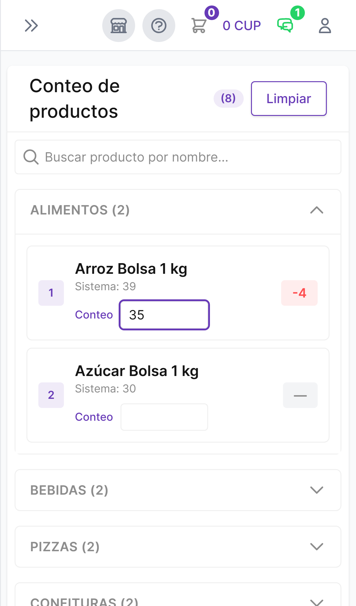

## 15. Entradas: del día e historial

**Qué es.** Registrar y consultar las entradas de mercancía.

**Cómo se hace.**
- **Entradas del día** (**Inventario → Entradas del día**): pulsa **Entrada**, elige producto,
  cantidad y costo, y guarda. Con el menú de la fila puedes **Editar** o **Eliminar**.
- **Historial** (**Inventario → Historial de entradas**, título **Entradas**): consulta por rango
  de fechas, agrupado por día. Es **solo lectura**.

**A tener en cuenta.** Solo el **Dueño** ve la columna de costo y las acciones del día. Una entrada
que ya se vendió no se puede anular. La fecha siempre es la del día.

**📷 Imagen sugerida.**

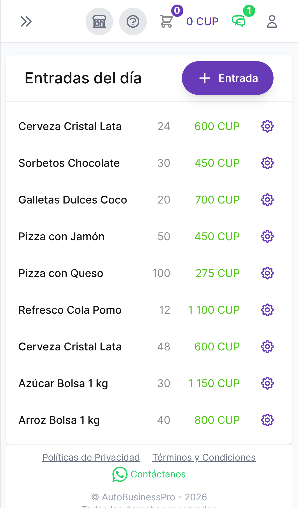

**Historial de entradas** (todos los días, agrupado por día):

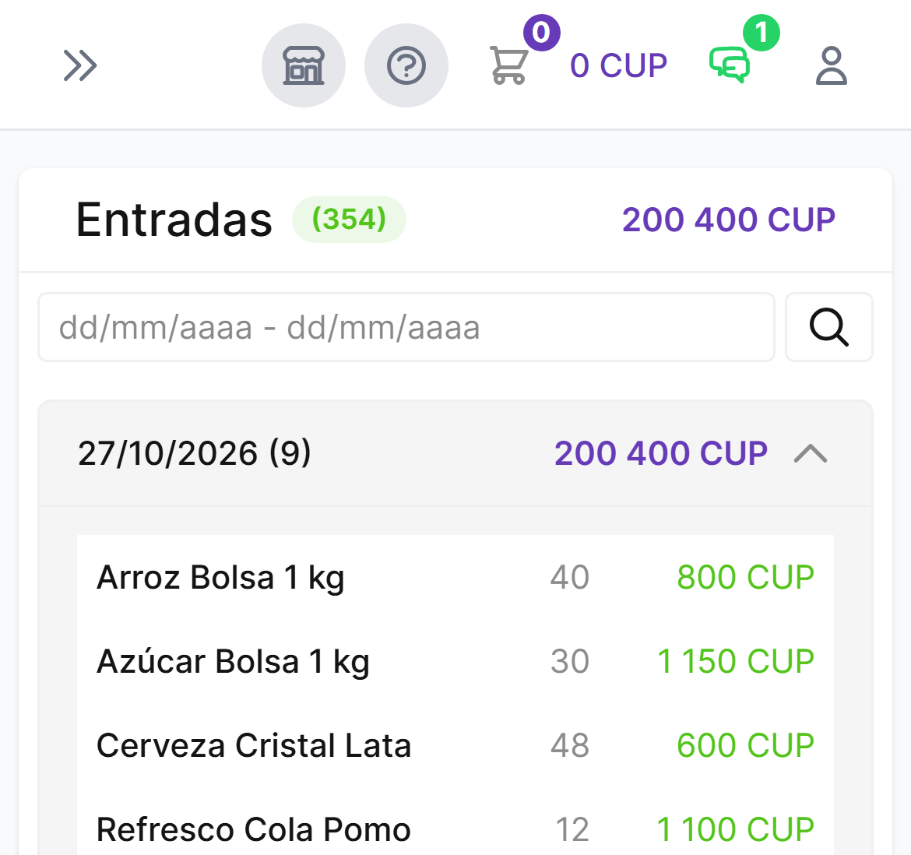

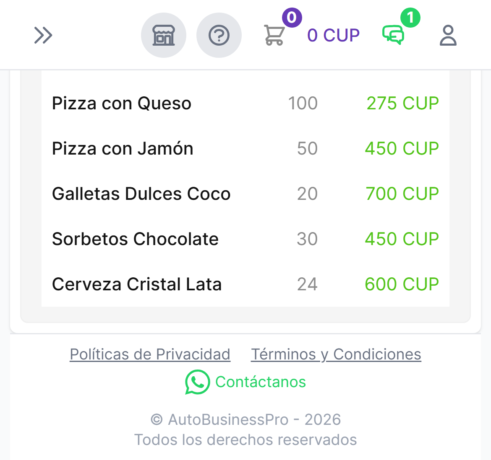

## 16. Cantidades del día

**Qué es.** Reconciliar, por producto, cómo se movió el inventario hoy.

**Cómo se hace.**
1. Ve a **Inventario → Cantidades del día**.
2. Revisa la tabla por producto: **Inicio · Entradas · Disponible · Vendido · Final**.

**A tener en cuenta.** Es **solo lectura**, sin filtros. Los valores negativos y los movimientos se
resaltan con color para que salten a la vista.

**📷 Imagen sugerida.**

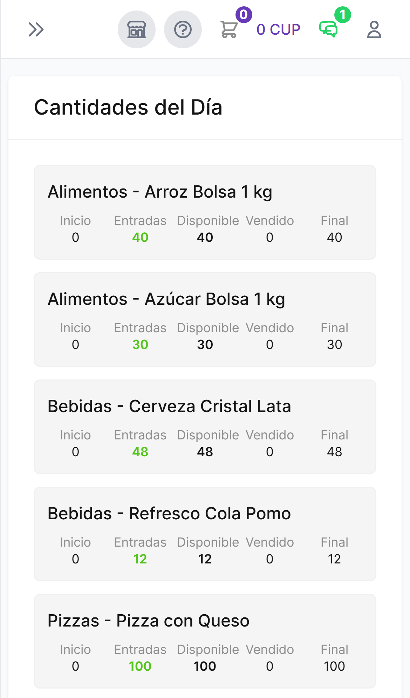

## 17. Ganancias del día

**Qué es.** El margen real del día: a qué precio se vendió y a qué costo.

**Cómo se hace.**
1. Ve a **Inventario → Ganancias del día**.
2. Revisa por producto el **Vendido**, **Precio**, **Costo** y la **Ganancia**, con el **Total**
   abajo.

**A tener en cuenta.** El costo sale del desglose **grabado en el momento de la venta** (no se
recalcula). La ganancia total se pinta en verde si es positiva y en rojo si es negativa.

**📷 Imagen sugerida.**

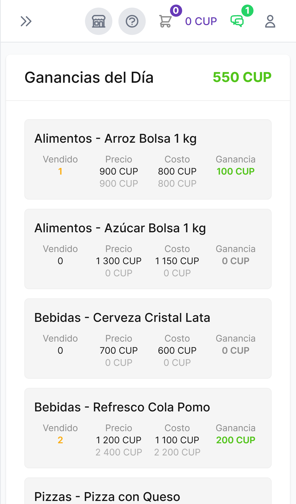

## 18. Salida

**Qué es.** Registrar una **salida de inventario que no es una venta**: una **merma** (producto
dañado, vencido o perdido), un **ajuste** de existencias o **otro** detalle que saca mercancía
del almacén.

**Cómo se hace.**
1. Ve a **Inventario → Salida**.
2. En **Tipo** elige **Merma**, **Ajuste** u **Otro**. El selector **no ofrece Normal ni
   Mayorista**: la venta normal se registra en **Vender** y la venta al por mayor en **Vender
   Mayorista**.
3. Navega por las categorías, añade los productos y sus cantidades y confirma desde el carrito,
   igual que en una venta.

**A tener en cuenta.** La salida comparte el carrito de la venta y el **tipo elegido queda
guardado en la orden**, para que puedas distinguir después una merma de un ajuste. El
inventario se descuenta según la casilla **Descuenta del Inventario** de cada producto, igual
que en una venta.

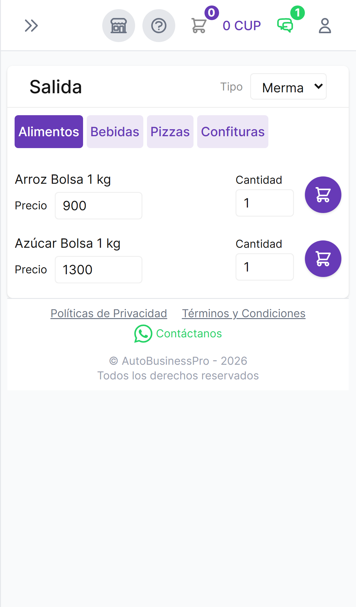

---

# Parte 4 — Catálogo Web y Pedidos WhatsApp

> A diferencia del resto del POS, estas pantallas **necesitan internet**: el catálogo publicado y
> los pedidos viven en el servidor.

## 19. Catálogo Web: publicar y presentación

**Qué es.** Publicar tu catálogo en internet para que tus clientes lo vean, y darle tu marca.

**Cómo se hace.**
1. Ve a **Ventas → Configuración** (**Catálogo Web**). Solo lo ve el **Dueño**.
2. Pulsa **Sincronizar Catálogo**: se publican tus categorías y productos (creados, actualizados y
   los desactivados). Verás el resultado de la sincronización.
3. Copia la **dirección pública** (botón **Copiar**) o ábrela con **Ver catálogo** para compartirla.
4. En la tarjeta **Marca**: sube tu **Logo** y elige **Productos por fila en móvil**
   (uno o dos). Pulsa **Guardar marca**.
5. En **Carrusel** e **Imágenes del día**: **Elegir imágenes** (hasta 10), opcionalmente un
   **Pie de foto**, y **Subir imágenes**. Puedes reordenar (subir/bajar) o quitar cada una.

**A tener en cuenta.** **Editar un producto no lo republica**: publicar es el acto explícito de
**Sincronizar Catálogo**. El logo del banner ya no se edita aquí. Los contadores de la cabecera te
dicen cuántas categorías, productos, publicados y sin imagen tienes.

**📷 Imagen sugerida.**

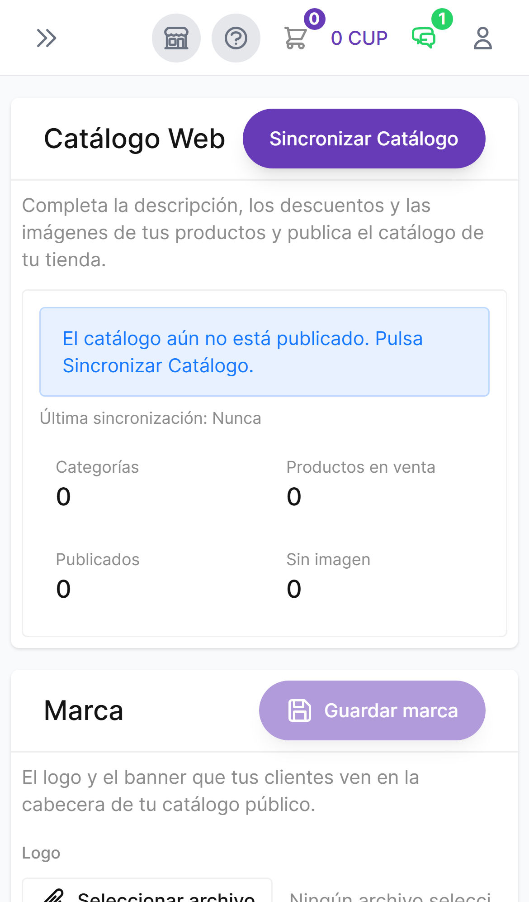

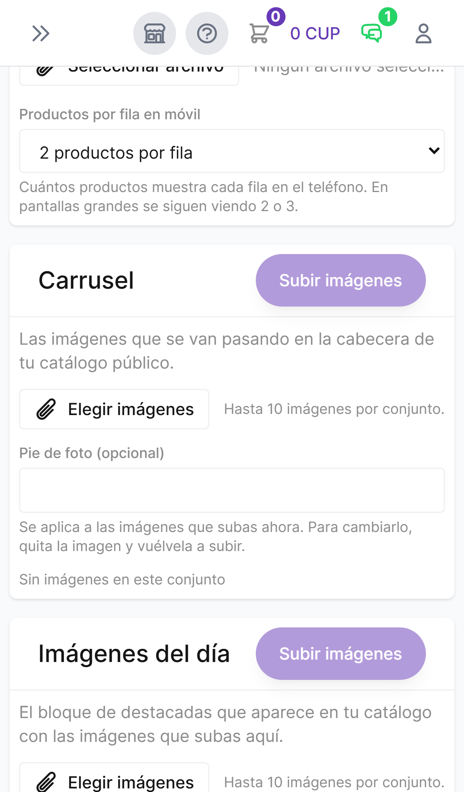

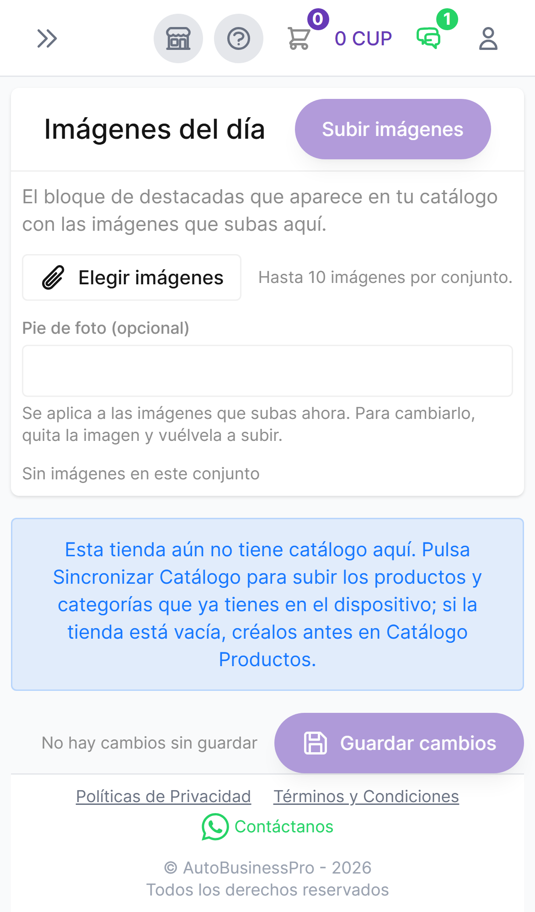

**Así lo ve el cliente** (ejemplo real del catálogo publicado):

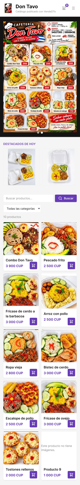

Cada producto se abre en una ficha con su foto, su precio y el botón **Añadir**:

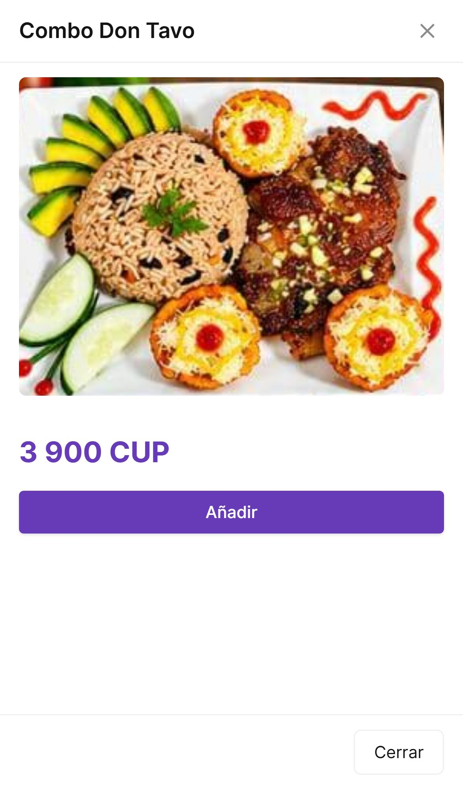

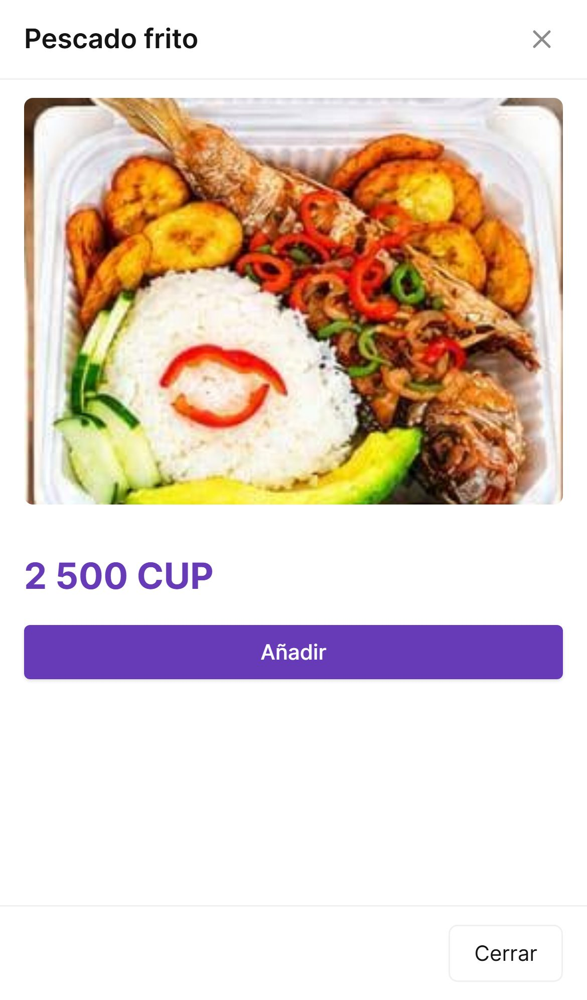

**Y así pide**: el **carrito** y el **checkout** los ve el **cliente**, no el POS. El ejemplo
sigue un pedido de **dos productos** (el primero con dos unidades), y el checkout llega al final
con los datos del cliente ya escritos:

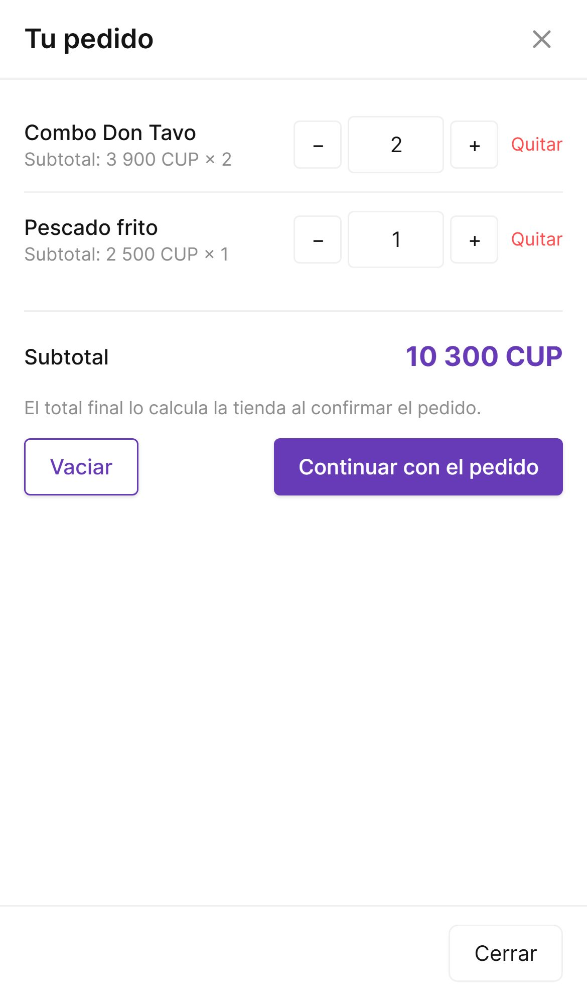

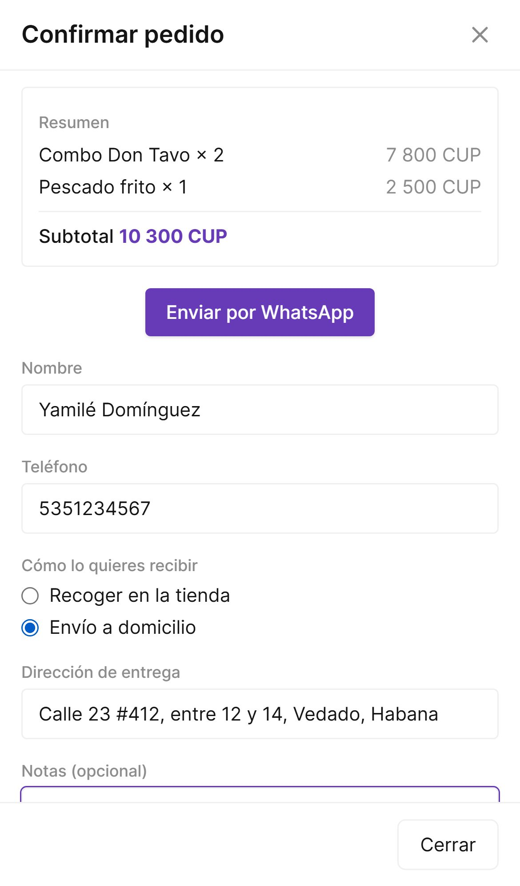

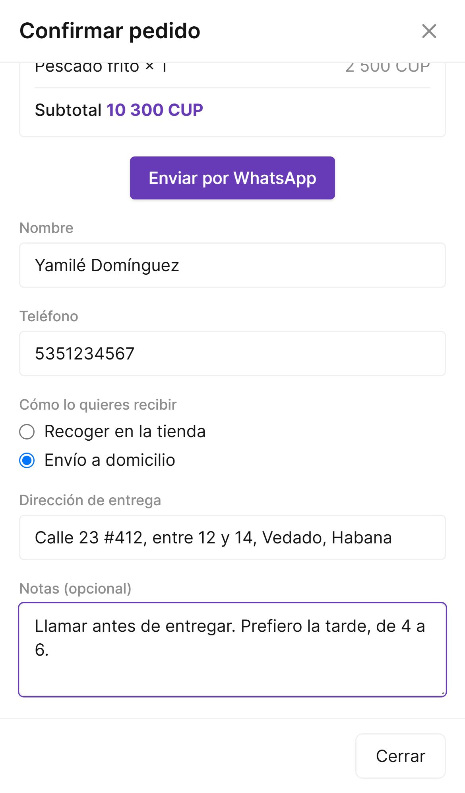

## 20. Editar los productos del catálogo (descripción e imagen)

**Qué es.** Completar el detalle que ve el cliente en el catálogo público.

**Cómo se hace.**
1. Dentro de **Catálogo Web**, expande una categoría.
2. En cada producto edita la **Descripción** (hay un contador de caracteres) y sube su **Imagen**.
3. Verás etiquetas como **Sin publicar**, **Nuevo** o **Sin guardar** según el estado.
4. Al terminar, pulsa **Guardar cambios** (arriba hay un resumen de pendientes).

**A tener en cuenta.** Hoy, en esta pantalla, se editan la **descripción y una imagen** por
producto; el porcentaje de descuento, el precio rebajado y la galería múltiple **no** están
disponibles aunque la ayuda del menú los mencione. Los cambios se guardan **por lotes** y lo que
falle se queda pendiente para reintentar.

**📷 Imagen sugerida.** Una categoría expandida con un producto cuyo editor muestra la **Descripción**
y la **Imagen**, y el resumen de pendientes con **Guardar cambios**.

## 21. Configurar los Pedidos WhatsApp

**Qué es.** Encender el pedido online y decir a dónde llega y cómo se entrega.

**Cómo se hace.**
1. Ve a **Ventas → Pedidos WhatsApp** (**Pedidos WhatsApp**). Solo lo ve el **Dueño**.
2. Activa el interruptor **Pedidos online**. Al encenderlo se muestra el resto.
3. Escribe el **Número de WhatsApp** donde quieres recibir los pedidos (obligatorio).
4. Activa **Recogida en la tienda** y/o **Envío a domicilio** (al menos una).
5. Rellena **Horario de atención** y **Zonas de reparto**, y pulsa **Sincronizar**.

**A tener en cuenta.** Una tienda nueva arranca con **Recogida** encendida. El precio y la moneda
del pedido salen del catálogo. Si el guardado va bien pero falla la recarga, se te avisa sin
perder lo escrito.

**📷 Imagen sugerida.**

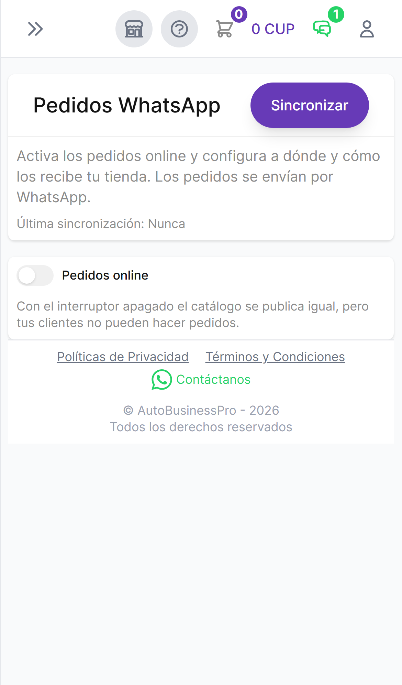

---

# Parte 5 — Gastos, Reportes y Estadísticas

## 22. Gastos

**Qué es.** Registrar los gastos operativos del día y consultarlos en el tiempo.

**Cómo se hace.**
1. **Gastos del día** (**Gastos → Gastos del día**): pulsa **Gasto**, elige el **Tipo**, escribe el
   **Total** (mayor que 0), la **moneda**, el **Tipo de pago** y una **Nota**, y guarda.
2. **Historial** (**Gastos → Gastos**): filtra por rango de fechas, por tipo de pago y por moneda;
   se agrupa por día.

**A tener en cuenta.** La **fecha la pone el sistema**. El historial es **solo lectura**. Los gastos
alimentan el **Cuadre del día** y las **Estadísticas**.

**📷 Imagen sugerida.**

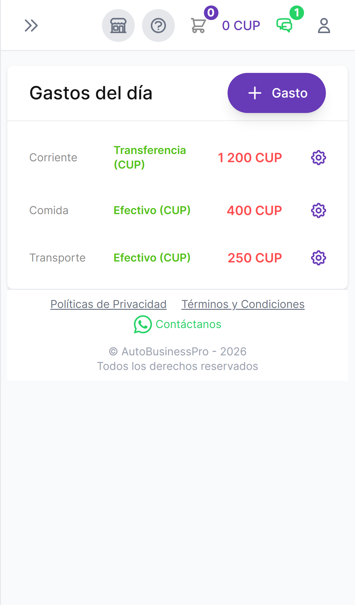

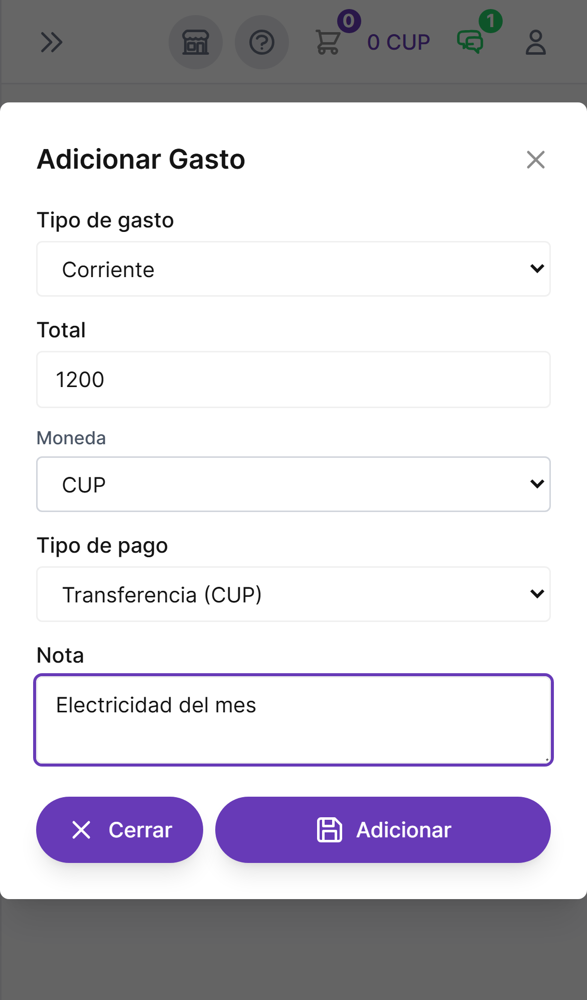

**Historial de gastos** (todos los días, agrupado por día):

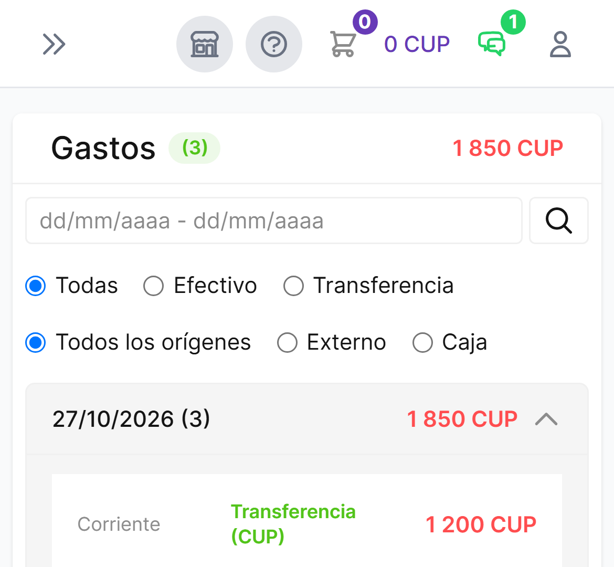

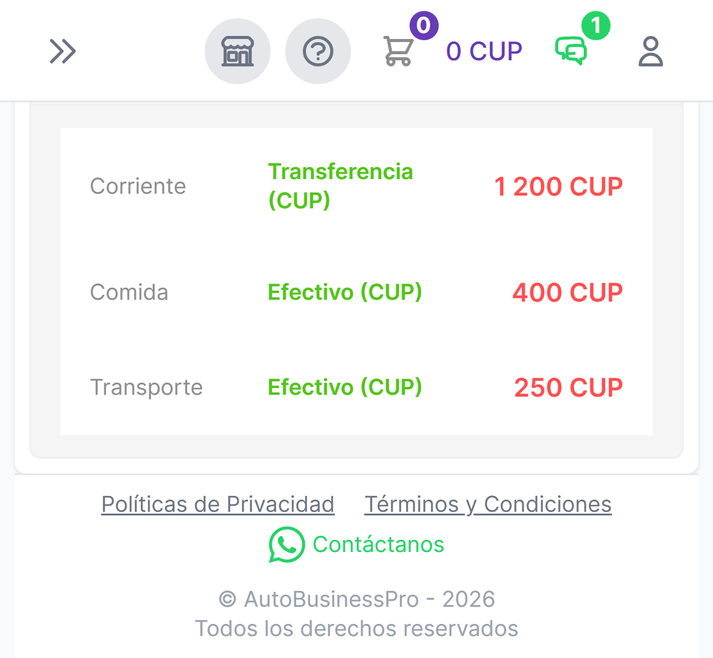

## 23. Reportes

**Qué es.** El resumen de ventas del día y la generación de un PDF de inventario a precio de venta.

**Cómo se hace.**
1. Ve a **Reportes → Reportes de hoy**.
2. Revisa las tarjetas: **Pedidos**, **Ingresos**, **Costo** y **Ganancia bruta**.
3. (Opcional) Elige la **moneda** y pulsa **Inventario a precio de venta** para descargar el PDF.

**A tener en cuenta.** El PDF **respeta el filtro de moneda** (si eliges una, el archivo lleva solo
esa moneda; no convierte).

**📷 Imagen sugerida.**

## 24. Panel de Control

**Qué es.** El tablero con la evolución del negocio en un rango de fechas.

**Cómo se hace.**
1. Ve a **Estadísticas → Dashboard** (**Panel de Control**).
2. Elige el **rango de fechas** (por defecto: los últimos **7 días**, terminando **ayer**).
3. Revisa los KPI y las gráficas de **Ventas** y **Ganancia**.

**A tener en cuenta.** Si tienes varias monedas, los importes se muestran **por moneda**, sin
conversión. Las secciones de **Gastos** y **Créditos** solo aparecen si esos módulos están activos.

**📷 Imagen sugerida.**

## 25. Cuadre por fechas

**Qué es.** El cuadre del periodo: ventas, gastos y ganancias entre dos fechas.

**Cómo se hace.**
1. Ve a **Estadísticas → Cuadre por fechas**.
2. Elige **Fecha inicio** y **Fecha fin** y pulsa **Generar**.
3. Revisa los cuatro KPI — **Ventas**, **Gastos**, **Ganancias Bruta** y **Ganancias** — y la
   tarjeta **Cuadre** con sus paneles colapsables.

**A tener en cuenta.** **Ganancias Bruta** es la ganancia **sin** restar gastos; **Ganancias** es
la bruta **menos** los gastos. La fecha de inicio debe ser anterior o igual a la de fin.

**📷 Imagen sugerida.**

---

# Parte 6 — Configuración y mantenimiento

## 26. Empleados y roster (resumen)

Ver la **sección 6** para crear empleados y la **sección 7** para el acceso sin conexión. Recuerda:
gestionar empleados **necesita conexión**, y el roster exportado es lo que habilita el equipo de un
empleado para trabajar sin internet.

**📷 Imagen sugerida.**

## 27. Tasas de Cambio

**Qué es.** Registrar cuántas unidades de cada moneda equivalen a **1 USD** para cada método de
pago. Solo aparece con el módulo de **múltiples monedas**.

**Cómo se hace.**
1. Ve a **Gestión → Tasas de Cambio**.
2. Pulsa **Tasa**, elige la **moneda** y el **método**, escribe el **valor de compra** y el
   **valor de venta**, y la **fecha desde la que rige**; pulsa **Registrar**.
3. Consulta **Tasas Vigentes** (las activas) y el **Historial de tasas**.

**A tener en cuenta.** El sistema es **append-only**: cada cambio crea una fila nueva y las filas
históricas **no se editan ni se borran**. La papelera solo **desactiva** (la saca del cálculo pero
la deja en el historial). **USD no aparece** en el selector (es la referencia). El **método** se
limita a los válidos para la moneda elegida.

**📷 Imagen sugerida.**

## 28. Configuraciones

Ver la **sección 3** (monedas y métodos de pago). En resumen, esta pantalla ofrece: **Tienda
activa** (solo multi-tienda), **Monedas de compra y venta** (solo con múltiples monedas) y
**Métodos de pago**. Guarda al instante.

**📷 Imagen sugerida.**

## 29. Mis tiendas

**Qué es.** Ver y gestionar todas tus tiendas (activas e inactivas).

**Cómo se hace.**
1. Ve a **Gestión → Mis tiendas**.
2. Con el engranaje de cada tarjeta puedes **Editar** (nombre, activar/desactivar) y **Editar el
   plan**.
3. Si tienes el módulo de multi-tienda, arriba hay un botón para **crear una tienda** nueva.

**A tener en cuenta.** Esta pantalla **necesita conexión**. Al crear una tienda, esta **nace en el
plan Superior** con su catálogo. Desactivar una tienda pide confirmación (puede ser la que tienes en
uso).

**📷 Imagen sugerida.**

## 30. Sincronización: exportar e importar

**Qué es.** Hacer una **copia de seguridad** cifrada de los datos de la tienda y **restaurarla**
(en el mismo u otro dispositivo).

**Cómo se hace — Exportar.**
1. Ve a **Sincronización → Exportar**.
2. Escribe la **Contraseña de cifrado**.
3. Pulsa **Exportar**: se descarga un archivo `.zip` (o compártelo por hotspot con **Compartir**).

**Cómo se hace — Importar.**
1. Ve a **Sincronización → Importar**.
2. Elige el **Archivo de respaldo (.zip)** (o recíbelo por hotspot) y escribe la contraseña.
3. Pulsa **Importar**.

**A tener en cuenta.** **Guarda la contraseña**: sin ella el respaldo no se puede abrir. La copia
incluye catálogo, inventario, ventas, gastos, créditos, métodos de pago, cierres de efectivo y más.
Al importar, los datos se **fusionan** con los del dispositivo (no se pisa a ciegas).

**📷 Imagen sugerida.**

## 31. Diagnóstico

**Qué es.** Una pantalla de soporte con el registro de errores y eventos del dispositivo. Solo la
ven el **Dueño** y el administrador de la plataforma.

**Cómo se hace.**
1. Ve a **Gestión → Diagnóstico**.
2. Revisa **Información del dispositivo** (versión, conexión, navegador).
3. Filtra por **nivel** o **busca** en la lista; usa **Compartir / Descargar / Copiar** para
   enviarlo a soporte y **Limpiar** para vaciarlo.

**A tener en cuenta.** Se actualiza solo cada segundo. Es la pantalla que conviene abrir cuando algo
falla, para enviar el detalle.

**📷 Imagen sugerida.**

---

## Anexo — Qué NO cubre este manual

Este manual se limita a los módulos del plan **Pago** más **Catálogo Web**, **Pedidos WhatsApp**,
las **configuraciones** y el **modo multi-tienda del historial de ventas** (cuando el módulo
MultiStores está activo). Quedan **fuera**: los módulos de **Almacenes** y **Elaboración** (plan
Superior), las pantallas de **Gestión de pedidos** (atender los pedidos, repartidores y ventas de
pedidos) y todas las pantallas de **Administración de la plataforma** (SuperAdmin: tiendas, dueños,
comercializadores, módulos, cobros y comisiones).

---

# Tutorial: agregar categorías y productos al catálogo del POS

Este tutorial es **independiente del resto del manual**: empieza desde cero y termina con un
producto listo para venderse en el POS. No necesitas leer ninguna otra sección.

**Qué vas a lograr.** Crear una **categoría** y, dentro de ella, un **producto** con su precio y su
existencia inicial, de modo que aparezca en **Vender** y pueda cobrarse.

**Cómo leer las imágenes.** Cada control que debes tocar está marcado con un **círculo rojo** y un
**número rojo**. Ese número es el **número de paso** de este tutorial y se repite en el texto. En
cada imagen verás solo los números que corresponden a esa pantalla.

> **No confundas las marcas con botones.** Las marcas del tutorial son **círculos rojos finos con un
> número**. Los botones de la aplicación (por ejemplo **Limpiar**, **Importar Productos** o
> **Categoría**) son formas rellenas con texto; si no llevan número, **no son un paso** de este
> tutorial.

**Antes de empezar.** Necesitas iniciar sesión como **Dueño de tienda** (o como un empleado con
permiso sobre **Productos**) y tener la tienda seleccionada. En el menú, el catálogo vive en el
grupo **VENTA**.

> **Categoría y producto, en una frase:** la **categoría** es el grupo (por ejemplo, *Alimentos*) y
> el **producto** es cada artículo que se vende dentro de ese grupo (por ejemplo, *Arroz Bolsa 1 kg*).
> **No se puede crear un producto sin una categoría.**

## 1. Abrir el catálogo de productos

**Paso 1.** Toca el botón de la esquina superior izquierda para **abrir el menú lateral**. Es el
botón con la flecha doble (**»**).

**Paso 2.** En el menú, dentro del grupo **VENTA**, toca **Catálogo Productos**. Se abre la pantalla
**Productos**.

## 2. Crear la categoría

**Paso 3.** En la pantalla **Productos**, toca el botón **Categoría** (con el signo **+**) que está
en la cabecera de la tarjeta.

Si el catálogo está vacío verás el aviso *«Para adicionar un producto debe primero adicionar una
categoría»*: es normal y desaparece en cuanto crees la primera.

Se abre la ventana **Crear categoría**, con tres campos y dos botones:

**Paso 4. Nombre.** Escribe el nombre del grupo. Es el texto que verás en la lista del catálogo y en
la pantalla de venta. Ejemplo: **Alimentos**. Es obligatorio.

**Paso 5. Orden.** Es la **posición** de la categoría en la lista: el número menor aparece primero.
Al abrir la ventana viene rellenado con el siguiente número libre, así que **normalmente no hay que
tocarlo**. Si escribes `1`, la categoría se coloca al principio. Es obligatorio.

**Paso 6. Activo.** Debe quedar **marcado**. Si lo desmarcas, la categoría se guarda pero queda
atenuada en la lista con la etiqueta **Inactivo**; no se borra y puedes volver a activarla editándola.

**Paso 7. Salvar.** Toca **Salvar** para guardar. El botón **Cerrar** (con la **×**) cierra la ventana
sin guardar.

Al guardar, la ventana se cierra y la categoría aparece en la lista **Productos** con un **0** a la
derecha: ese número es la **cantidad de productos** que contiene (todavía ninguno).

## 3. Abrir el menú de la categoría

**Paso 8.** Toca el **engranaje** que está a la derecha del nombre de la categoría (justo antes de la
flecha que abre y cierra el grupo). Ese engranaje son las **opciones de la categoría** y **no**
expande la lista.

Se abre un **menú contextual** con tres opciones. Esta es la parte que no es evidente: **dos de las
tres opciones sirven para agregar productos**.

**Paso 9. Categoría** (icono de lápiz). **Edita** la categoría: vuelve a abrir la ventana del paso 4
para cambiar **Nombre**, **Orden** o **Activo**. No agrega productos.

**Paso 10. Productos** (icono **+**). **Alta rápida de varios productos** a la vez: escribes una lista
de nombres y precios y se crean todos dentro de la categoría. Útil para cargar un catálogo largo.

**Paso 11. Producto** (icono **+**). **Alta individual**: abre el formulario completo con todos los
campos del producto. Es la opción que usaremos en este tutorial.

## 4. Crear el producto

**Paso 11 (continuación).** Toca **Producto** en el menú contextual. Se abre la ventana **Producto**.
El formulario es largo, así que se muestra en dos imágenes: primero los datos generales y después las
casillas y los botones finales.

**Paso 12. Nombre.** El nombre del artículo tal como lo verás en la lista y en la pantalla de venta.
Ejemplo: **Arroz Bolsa 1 kg**. Es obligatorio.

**Paso 13. Precio de costo.** Lo que te cuesta a ti una unidad. Es **opcional**. Si lo rellenas junto
con **Cantidad**, el sistema registra una **entrada de inventario del día** con ese costo y esa
cantidad. Si lo dejas vacío, **no** se crea ninguna entrada. El costo **no cambia** el precio de
venta. Este campo solo aparece para el **Dueño** y con el módulo **Inventario** activo.

**Paso 14. Precio.** El precio al que vendes una unidad. Es **obligatorio** y debe ser un número mayor
o igual que cero. Es el precio que verás en la lista del catálogo y el que se cobra en el POS.

**Paso 15. Moneda del costo.** La moneda en la que expresas el **Precio de costo**. Solo aparece con
el módulo **MultiMonedas**; por defecto trae la moneda de compra configurada en la tienda.

**Paso 16. Moneda del precio.** La moneda en la que expresas el **Precio** de venta. Solo aparece con
el módulo **MultiMonedas**. Si cambias primero la moneda del costo, la del precio se ajusta sola la
primera vez; después puedes fijarla por separado.

**Paso 17. Cantidad.** La **existencia inicial** que tienes de ese producto. Es **opcional** y admite
decimales (por ejemplo `1.5`). Solo crea la entrada de inventario del día si **también** rellenaste el
**Precio de costo** y la cantidad es mayor que cero.

**Paso 18. Código de barras.** El código del producto, si tiene. Es **opcional**. Puedes escribirlo o
tocarlo con el botón del **escáner** (icono de código de barras) para capturarlo con la cámara.

**Paso 19. Orden.** La **posición** del producto dentro de la categoría: el número menor aparece
primero. Viene rellenado con el siguiente número libre, así que **normalmente no hay que tocarlo**.

**Paso 20. Venta Mayorista.** Es un **interruptor opcional**, apagado por defecto. Si lo enciendes,
aparecen **Unidades por paquete/caja**, **Unidad de medida** y los **Rangos de precio mayorista**
(mínimo de paquetes y precio por unidad). Si no vendes al mayor, déjalo apagado.

**Paso 21. Activo.** Debe quedar **marcado**. Si lo desmarcas, el producto se guarda pero queda
atenuado en la lista con la etiqueta **Inactivo** y **no se puede vender**.

**Paso 22. Disponible para Vender.** Debe quedar **marcado**. Si lo desmarcas, el producto existe en el
catálogo pero **no aparece en la pantalla Vender**, así que no se puede cobrar.

**Paso 23. Descuenta del Inventario.** Debe quedar **marcado** para un producto normal: el POS controla
la existencia y la descuenta al vender. Desmárcalo solo para artículos que **no llevan inventario**
(servicios, combos): en ese caso se vende aunque no haya existencia y no descuenta stock.

**Paso 24. Salvar.** Toca **Salvar** para guardar el producto. El botón **Cerrar** (con la **×**)
cierra sin guardar.

## 5. Comprobar que quedó listo

**Paso 25.** La ventana se cierra y el producto aparece **dentro de la categoría**. Toca el nombre de
la categoría (o la flecha de la derecha) para **abrir el grupo** si está cerrado. Verás el producto
con su **precio** y su **engranaje** de opciones (para **Editar** o **Desactivar** el producto más
adelante). El número a la derecha del nombre de la categoría pasa de **0** a **1** (o al total de
productos que tenga).

**Listo.** El producto ya existe en el catálogo del POS: aparece en **Vender**, se puede agregar al
carrito y cobrar, y si marcaste **Descuenta del Inventario** su existencia se irá descontando con cada
venta.

## Resumen de los campos

### Ventana Crear categoría

| Campo | Qué significa | ¿Obligatorio? |
| --- | --- | --- |
| **Nombre** | Nombre del grupo que verás en el catálogo y en la venta. | Sí |
| **Orden** | Posición en la lista; el número menor aparece primero. Viene con el siguiente libre. | Sí |
| **Activo** | Marcado: la categoría se usa normalmente. Desmarcado: queda atenuada como **Inactivo**, sin borrarse. | No (marcado por defecto) |

### Ventana Producto

| Campo | Qué significa | ¿Obligatorio? |
| --- | --- | --- |
| **Nombre** | Nombre del artículo en el catálogo y en la venta. | Sí |
| **Precio de costo** | Lo que te cuesta una unidad. Con **Cantidad**, genera la entrada de inventario del día. No cambia el precio de venta. | No |
| **Precio** | Precio de venta por unidad. Es el que se cobra en el POS. | Sí |
| **Moneda del costo** | Moneda del costo (solo con MultiMonedas). | No |
| **Moneda del precio** | Moneda del precio de venta (solo con MultiMonedas). | No |
| **Cantidad** | Existencia inicial; admite decimales. Solo genera entrada si hay costo y es mayor que cero. | No |
| **Código de barras** | Código del producto; se puede escribir o escanear. | No |
| **Orden** | Posición dentro de la categoría; el número menor aparece primero. | No |
| **Venta Mayorista** | Interruptor para configurar paquete/caja, unidad de medida y rangos de precio al mayor. | No (apagado por defecto) |
| **Activo** | Marcado: el producto se usa normalmente. Desmarcado: queda **Inactivo** y no se vende. | No (marcado por defecto) |
| **Disponible para Vender** | Marcado: aparece en **Vender**. Desmarcado: no se puede cobrar. | No (marcado por defecto) |
| **Descuenta del Inventario** | Marcado: controla y descuenta existencia al vender. Desmarcado: no controla stock (servicios, combos). | No (marcado por defecto) |

### Botones de la pantalla Productos

| Botón | Qué hace |
| --- | --- |
| **Categoría** | Crea una categoría nueva (paso 3). |
| **Importar Productos** | Carga masiva desde un archivo CSV: descarga el ejemplo, rellénalo y súbelo. |
| **Importar desde Catálogo Web** | Trae al catálogo del POS los productos publicados en el Catálogo Web (solo Dueño y con el módulo activo). |
| **Limpiar** | **Borra** los datos del catálogo de este dispositivo (solo Dueño). **No lo uses** en este tutorial. |

### Botones de la ventana Producto

| Botón | Qué hace |
| --- | --- |
| **Cerrar** (**×**) | Cierra la ventana sin guardar nada. |
| **Salvar** (icono de disquete) | Guarda el producto con los datos escritos. |

